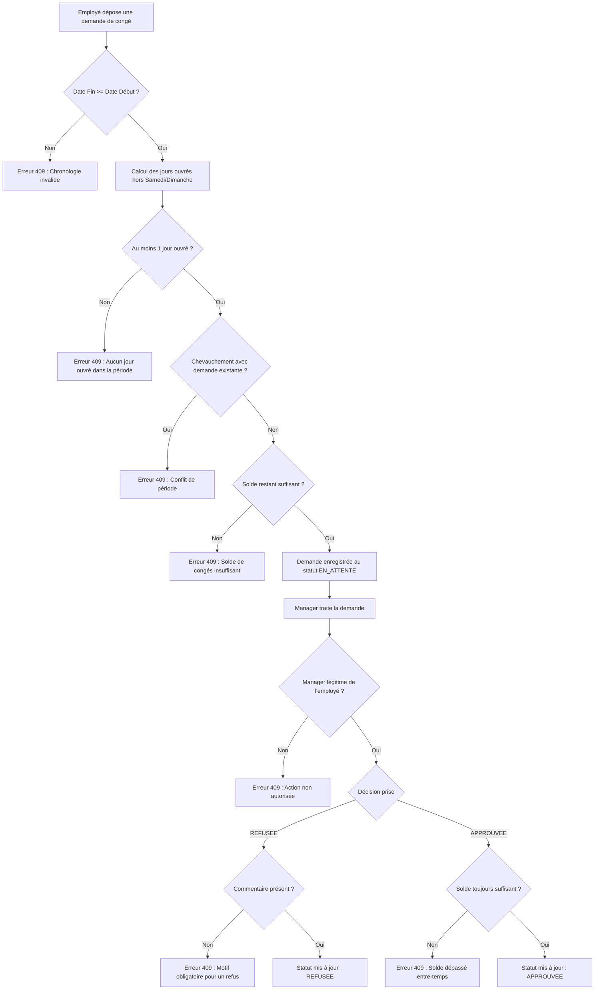
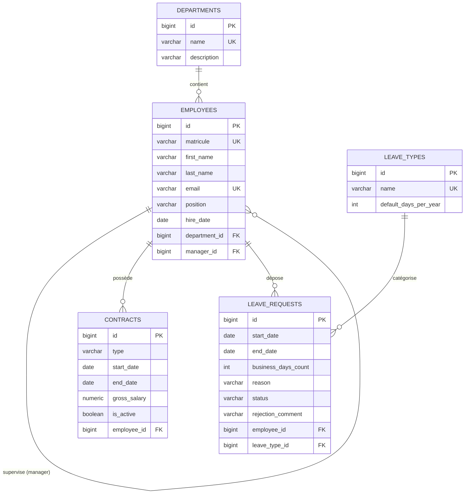

# AtlasRH - Human Resources Management System (API REST)

[](https://spring.io/projects/spring-boot)
[](https://www.oracle.com/java/)
[](https://www.postgresql.org/)
[](https://www.liquibase.org/)
[](http://localhost:8080/swagger-ui/index.html)
[](https://lemtiriabdellah.atlassian.net/jira/software/projects/AT/boards/134?filter=&groupBy=none&atlOrigin=eyJpIjoiNmZlNjJmZDg0ZWQ0NDkyNzliMGIxZjg4MzU4ZTIxMjEiLCJwIjoiaiJ9)

---

## 📌 Présentation & Contexte Métier

**AtlasRH** est une solution backend robuste conçue pour répondre aux enjeux de pilotage des ressources humaines d'une entreprise en pleine croissance comptant **250 collaborateurs**. 

Développée selon les standards stricts du génie logiciel et de l'écosystème **Spring**, l'API REST centralise l'ensemble du cycle de vie des talents en entreprise :
1. **Module Responsable RH (Livrable 1)** : Organisation structurelle en départements, tenue du registre des collaborateurs avec gestion hiérarchique, et cycle de vie des contrats de travail (CDI, CDD, Stage).
2. **Portails Employé & Manager (Livrable 2 Final)** : Espace collaborateur en libre-service pour la pose de congés, suivi des soldes par typologie et calcul d'ancienneté, couplé à un circuit de validation managériale étanche avec contrôle automatique des soldes et des périodes d'absence.

* **Auteur du projet** : **Abdellah Lemtiri**
* **Suivi de projet & Planification Agile** : [Suivi du Projet & Planification Jira](https://lemtiriabdellah.atlassian.net/jira/software/projects/AT/boards/134?filter=&groupBy=none&atlOrigin=eyJpIjoiNmZlNjJmZDg0ZWQ0NDkyNzliMGIxZjg4MzU4ZTIxMjEiLCJwIjoiaiJ9)

---

## 🛠 Stack Technique & Dépendances

| Catégorie | Technologie | Rôle dans le projet |
| :--- | :--- | :--- |
| **Langage & Socle** | **Java 17 (LTS)** | Programmation moderne, Record semantics, typage strict et performances. |
| **Framework Backend** | **Spring Boot 3** | Inversion de contrôle, conteneur IoC, Web MVC, Transactions déclaratives. |
| **Persistance & ORM** | **Spring Data JPA / Hibernate 6+** | Couche repository, requêtes dérivées, requêtes JPQL paramétrées et lazy loading. |
| **Base de Données** | **PostgreSQL 17** | Moteur relationnel robuste garantissant l'intégrité référentielle ACID. |
| **Gestion du Schéma** | **Liquibase** | Versioning déclaratif de la base de données (DDL) et seed de test (DML). |
| **Transformation / DTO** | **MapStruct 1.5.5** | Génération de mappers ultra-rapides au build sans réflexion dynamique. |
| **Validation des Données** | **Hibernate Validator** | Contrôle des contraintes en amont (`@NotNull`, `@NotBlank`, `@Size`, `@FutureOrPresent`). |
| **Documentation Vivante** | **SpringDoc OpenAPI 2.8.5** | Génération automatique des contrats OpenAPI 3 et Swagger UI interactif. |
| **Productivité** | **Lombok** | Élimination du boilerplate code (`@Getter`, `@Setter`, `@Builder`, `@RequiredArgsConstructor`). |
| **Journalisation** | **SLF4J / Logback** | Traçabilité des opérations critiques et audit des règles métier. |
| **Gestion de build** | **Apache Maven 3.8+** | Cycle de vie de compilation, packaging JAR et résolution des dépendances. |

---

## ⚙️ Guide d'Installation et de Démarrage

### 1. Prérequis Système
* **JDK 17** installé et configuré dans votre variable d'environnement `JAVA_HOME`.
* **PostgreSQL 17** actif et accessible sur le port local par défaut `5432`.
* **Apache Maven 3.8+** (ou utilisation du wrapper fourni `./mvnw`).

### 2. Configuration de la Base de Données
Créez la base de données relationnelle via votre client PostgreSQL préféré (`psql`, pgAdmin, DBeaver) :

```sql
CREATE DATABASE atlasrh_db;
```

Ajustez si nécessaire vos identifiants d'accès dans le fichier [`src/main/resources/application.yaml`](file:///atlasrh-api/src/main/resources/application.yaml) :

```yaml
spring:
  datasource:
    url: ${DB_URL:jdbc:postgresql://localhost:5432/atlasrh_db}
    username: ${DB_USERNAME:postgres}
    password: ${DB_PASSWORD:admin123}
    driver-class-name: org.postgresql.Driver

  jpa:
    hibernate:
      ddl-auto: validate
    properties:
      hibernate:
        format_sql: true
    show-sql: true

  liquibase:
    change-log: classpath:db/changelog/db.changelog-master.yaml
    enabled: true

springdoc:
  api-docs:
    path: /v3/api-docs
  swagger-ui:
    path: /swagger-ui.html
  default-flat-param-object: true
```

> **Remarque :** Grâce à `spring.jpa.hibernate.ddl-auto: validate`, Hibernate ne modifie pas le schéma ; **Liquibase** applique rigoureusement les scripts de migration ordonnés (`01-create-tables.yaml`) puis injecte le jeu de données de test (`02-insert-demo-data.yaml`) contenant 5 départements et 30 collaborateurs hiérarchisés.

### 3. Compilation & Exécution

Placez-vous dans le sous-dossier `atlasrh-api` et lancez les commandes Maven :

```bash
# Compilation et téléchargement des dépendances
mvn clean install

# Démarrage du serveur Spring Boot embarqué (Tomcat port 8080)
mvn spring-boot:run
```

Ou en utilisant le Maven Wrapper :
```bash
./mvnw clean install
./mvnw spring-boot:run
```

### 4. Accès à la Documentation Interactive Swagger UI

Dès que le serveur affiche `Started AtlasrhApiApplication in X.XXX seconds`, ouvrez votre navigateur :

* 🌐 **Swagger UI Interactif :** [http://localhost:8080/swagger-ui/index.html](http://localhost:8080/swagger-ui/index.html)
* 📄 **Spécification OpenAPI (JSON) :** [http://localhost:8080/v3/api-docs](http://localhost:8080/v3/api-docs)

---

## 🏛 Architecture en Couches & Conventions

Le projet applique une **Layered Architecture** unidirectionnelle stricte garantissant une séparation nette des responsabilités, une haute testabilité et une sécurité maximale du domaine métier.

```
Client HTTP (Postman / Frontend / Mobile)
       │
       ▼
┌─────────────────────────────────────────────────────────────┐
│ 1. Couche Présentation : com.atlasrh.controller             │
│    - Réception des requêtes HTTP & Sérialisation JSON       │
│    - Validation des inputs via Jakarta Bean Validation      │
│    - Documentation interactive OpenAPI                      │
└──────────────────────────────┬──────────────────────────────┘
                               │ Request DTOs
                               ▼
┌─────────────────────────────────────────────────────────────┐
│ 2. Couche Métier : com.atlasrh.service / impl               │
│    - Délimitation transactionnelle (@Transactional)         │
│    - Contrôle des invariants et règles de gestion           │
│    - Transformation DTO <-> Entité via MapStruct            │
│    - Déclenchement d'exceptions métier personnalisées       │
└──────────────────────────────┬──────────────────────────────┘
                               │ Entités JPA
                               ▼
┌─────────────────────────────────────────────────────────────┐
│ 3. Couche Accès aux Données : com.atlasrh.repository        │
│    - Interfaces Spring Data JPA                             │
│    - Requêtes dérivées & JPQL typé                          │
│    - Gestion de la pagination & tri (Pageable)              │
└──────────────────────────────┬──────────────────────────────┘
                               │ SQL
                               ▼
┌─────────────────────────────────────────────────────────────┐
│ 4. Persistance : Base PostgreSQL 17 (Migrations Liquibase)  │
└─────────────────────────────────────────────────────────────┘
```

### 🛡 Règle d'or Architecturale : Isolation Complète des Entités JPA
> **Les entités JPA (`@Entity`) ne franchissent jamais le périmètre de la couche Service.**
> 
> * Les contrôleurs REST consomment exclusivement des **Request DTOs** et retournent des **Response DTOs**.
> * Cette isolation empêche les effets de bord indésirables (problème N+1 lors de sérialisations incontrôlées, fuite d'informations sensibles, boucles infinies de sérialisation bidirectionnelle `@JsonBackReference/@JsonManagedReference`).
> * La conversion entre entités et DTOs est confiée à **MapStruct** (`@Mapper(componentModel = "spring")`), générant à la compilation du code Java pur, exempt de tout surcoût de réflexion.

---

### 📂 Arborescence Détaillée des Packages

```text
com.atlasrh
├── config/                         # Configuration OpenAPI, beans Swagger, sécurité
│   └── OpenApiConfig.java
├── controller/                     # Endpoints REST exposés aux clients
│   ├── ContractController.java
│   ├── DepartmentController.java
│   ├── EmployeeController.java
│   ├── EmployeePortalController.java
│   └── ManagerController.java
├── dto/
│   ├── request/                    # Objets de requête validés (@Valid)
│   │   ├── ContractRequestDTO.java
│   │   ├── DepartmentRequestDTO.java
│   │   ├── EmployeeRequestDTO.java
│   │   ├── LeaveDecisionRequestDTO.java
│   │   └── LeaveRequestCreateDTO.java
│   └── response/                   # DTOs de réponse renvoyés par l'API
│       ├── ContractResponseDTO.java
│       ├── DepartmentResponseDTO.java
│       ├── EmployeeResponseDTO.java
│       ├── EmployeeSeniorityResponseDTO.java
│       ├── LeaveBalanceResponseDTO.java
│       └── LeaveRequestResponseDTO.java
├── entity/                         # Modèle relationnel persisté (JPA / Hibernate)
│   ├── Contract.java
│   ├── Department.java
│   ├── Employee.java
│   ├── LeaveRequest.java
│   ├── LeaveType.java
│   └── enums/                      # Types énumérés métier
│       ├── ContractType.java       # CDI, CDD, STAGE
│       └── LeaveStatus.java        # EN_ATTENTE, APPROUVEE, REFUSEE, ANNULEE
├── exception/                      # Gestion centralisée et uniforme des erreurs
│   ├── BusinessException.java      # Déclenche un code HTTP 409 Conflict
│   ├── GlobalExceptionHandler.java # @RestControllerAdvice intercepteur
│   └── ResourceNotFoundException.java # Déclenche un code HTTP 404 Not Found
├── mapper/                         # Interfaces de conversion MapStruct
│   ├── ContractMapper.java
│   ├── DepartmentMapper.java
│   ├── EmployeeMapper.java
│   └── LeaveRequestMapper.java
├── repository/                     # DAO Spring Data JPA
│   ├── ContractRepository.java
│   ├── DepartmentRepository.java
│   ├── EmployeeRepository.java
│   ├── LeaveRequestRepository.java
│   └── LeaveTypeRepository.java
├── service/                        # Contrats de service métier
│   ├── ContractService.java
│   ├── DepartmentService.java
│   ├── EmployeeLeaveService.java
│   ├── EmployeeService.java
│   ├── ManagerService.java
│   └── impl/                       # Implémentations et logique métier
│       ├── ContractServiceImpl.java
│       ├── DepartmentServiceImpl.java
│       ├── EmployeeLeaveServiceImpl.java
│       ├── EmployeeServiceImpl.java
│       └── ManagerServiceImpl.java
└── util/                           # Classes utilitaires transverses
    └── DateUtils.java              # Calcul précis des jours ouvrés (exclut Samedi/Dimanche)
```

---

### 🚦 Standardisation des Codes Retours HTTP

L'ensemble des retours d'API et anomalies est pris en charge par `GlobalExceptionHandler` :

| Code HTTP | Statut | Signification et Contexte d'utilisation | Format de Réponse |
| :---: | :--- | :--- | :--- |
| **`200`** | **OK** | Succès pour les requêtes de consultation (`GET`), mise à jour (`PUT`) ou transition (`PATCH`). | Corps JSON de la ressource demandée. |
| **`201`** | **Created** | Ressource créée avec succès en base de données (`POST`). | Corps JSON de l'objet créé avec son identifiant. |
| **`204`** | **No Content** | Suppression effective (`DELETE`). Aucun contenu n'est renvoyé. | Corps vide. |
| **`400`** | **Bad Request** | Erreur de validation de format ou contrainte violée sur un DTO d'entrée (`@Valid`). | JSON listant les attributs invalides et les messages d'erreur. |
| **`404`** | **Not Found** | Ressource ciblée inexistante en base (`ResourceNotFoundException`). | JSON standardisé avec timestamp, statut et message explicatif. |
| **`409`** | **Conflict** | Violation d'une règle métier (`BusinessException`) : doublon d'email/matricule, suppression d'un département non vide, solde insuffisant, etc. | JSON standardisé avec timestamp, statut et message d'erreur métier. |

---

## 📖 Catalogue Exhaustif des Endpoints de l'API

### 🏢 1. Module Responsable RH — Gestion des Départements
Gère les pôles d'activité de l'entreprise avec garantie d'intégrité référentielle.

| Méthode | URI | Description | Codes HTTP |
| :--- | :--- | :--- | :---: |
| `POST` | `/api/departments` | Créer un nouveau département (nom unique). | `201`, `400`, `409` |
| `GET` | `/api/departments` | Lister l'intégralité des départements. | `200` |
| `GET` | `/api/departments/{id}` | Consulter le détail d'un département par ID. | `200`, `404` |
| `PUT` | `/api/departments/{id}` | Mettre à jour l'intitulé et la description. | `200`, `400`, `404`, `409` |
| `DELETE` | `/api/departments/{id}` | Supprimer un département (**interdit si des collaborateurs y sont rattachés**). | `204`, `404`, `409` |

#### Exemple Payload : Création d'un Département (`POST /api/departments`)
```json
{
  "name": "Direction des Systèmes d'Information",
  "description": "Pôle ingénierie logicielle, infrastructures cloud et cybersécurité"
}
```

---

### 👥 2. Module Responsable RH — Gestion des Employés
Registre central des collaborateurs avec recherche multicritère, pagination, tri et rattachement hiérarchique.

| Méthode | URI | Description | Codes HTTP |
| :--- | :--- | :--- | :---: |
| `POST` | `/api/employees` | Enregistrer un nouvel employé (unicité matricule & email). | `201`, `400`, `409` |
| `GET` | `/api/employees` | Lister les employés avec recherche, filtre département et pagination (`search`, `departmentId`, `page`, `size`, `sort`). | `200` |
| `GET` | `/api/employees/{id}` | Consulter la fiche complète d'un collaborateur. | `200`, `404` |
| `PUT` | `/api/employees/{id}` | Modifier les informations d'un collaborateur (contrôle anti auto-management). | `200`, `400`, `404`, `409` |
| `GET` | `/api/employees/manager/{managerId}/team` | Consulter l'ensemble des subordonnés directs rattachés à un manager. | `200`, `404` |

#### Exemple Payload : Création d'un Employé (`POST /api/employees`)
```json
{
  "matricule": "EMP031",
  "firstName": "Yassine",
  "lastName": "El Amrani",
  "email": "y.elamrani@atlasrh.com",
  "position": "Ingénieur DevOps",
  "hireDate": "2024-03-01",
  "departmentId": 2,
  "managerId": 1
}
```

#### Exemple de Réponse Paginée (`GET /api/employees?page=0&size=2&sort=lastName,asc`)
```json
{
  "content": [
    {
      "id": 2,
      "matricule": "EMP002",
      "firstName": "Sara",
      "lastName": "Alami",
      "email": "s.alami@atlasrh.com",
      "position": "Directrice des Ressources Humaines",
      "hireDate": "2020-03-01",
      "departmentId": 1,
      "departmentName": "Ressources Humaines",
      "managerId": null,
      "managerFullName": null
    },
    {
      "id": 6,
      "matricule": "EMP006",
      "firstName": "Mehdi",
      "lastName": "Benkirane",
      "email": "m.benkirane@atlasrh.com",
      "position": "Lead Tech Java",
      "hireDate": "2021-02-01",
      "departmentId": 2,
      "departmentName": "Informatique",
      "managerId": 1,
      "managerFullName": "Karim Bennani"
    }
  ],
  "pageable": { "pageNumber": 0, "pageSize": 2 },
  "totalElements": 30,
  "totalPages": 15,
  "last": false
}
```

---

### 📄 3. Module Responsable RH — Gestion des Contrats
Suivi contractuel du personnel avec règles de cohérence de dates et unicité de contrat actif.

| Méthode | URI | Description | Codes HTTP |
| :--- | :--- | :--- | :---: |
| `POST` | `/api/contracts` | Établir un contrat pour un collaborateur (contrôle contrat actif unique, date de fin obligatoire pour CDD/STAGE). | `201`, `400`, `404`, `409` |
| `PATCH` | `/api/contracts/{id}/terminate` | Clôturer prématurément un contrat en cours (`isActive = false`, réajustement de `endDate`). | `200`, `404`, `409` |
| `GET` | `/api/contracts/employee/{employeeId}` | Consulter l'historique chronologique des contrats d'un collaborateur. | `200`, `404` |

#### Exemple Payload : Création de Contrat (`POST /api/contracts`)
```json
{
  "employeeId": 16,
  "type": "CDI",
  "startDate": "2024-01-01",
  "endDate": null,
  "grossSalary": 18500.00
}
```

---

### 🏖 4. Portail Employé — Libre-Service Congés & Droits (Livrable 2)
Espace dédié au collaborateur lui permettant d'administrer ses congés et consulter ses droits acquis en totale autonomie.

| Méthode | URI | Description | Codes HTTP |
| :--- | :--- | :--- | :---: |
| `POST` | `/api/employee/{employeeId}/leave-requests` | Poser une demande d'absence (calcul automatique des jours ouvrés, exclusion week-ends, contrôle de chevauchement et solde). | `201`, `400`, `404`, `409` |
| `GET` | `/api/employee/{employeeId}/leave-requests` | Consulter ses demandes avec filtre optionnel par statut (`?status=EN_ATTENTE`). | `200`, `404` |
| `PATCH` | `/api/employee/{employeeId}/leave-requests/{requestId}/cancel` | Annuler une demande personnelle (**uniquement si statut `EN_ATTENTE`**). | `200`, `404`, `409` |
| `GET` | `/api/employee/{employeeId}/leave-balances` | Consulter ses soldes annuels restants découpés par type de congé. | `200`, `404` |
| `GET` | `/api/employee/{employeeId}/seniority` | Calculer l'ancienneté précise du collaborateur (en années et mois révolus). | `200`, `404` |

#### Exemple Payload : Soumission d'une Demande de Congé (`POST /api/employee/16/leave-requests`)
```json
{
  "leaveTypeId": 1,
  "startDate": "2026-11-16",
  "endDate": "2026-11-20",
  "reason": "Congés annuels d'automne pour convenance personnelle"
}
```

#### Exemple de Réponse : Solde des Congés (`GET /api/employee/16/leave-balances`)
```json
[
  {
    "leaveTypeId": 1,
    "leaveTypeName": "Congé Payé Annuel",
    "defaultDaysPerYear": 22,
    "approvedDays": 10,
    "remainingBalance": 12
  },
  {
    "leaveTypeId": 2,
    "leaveTypeName": "Congé Maladie",
    "defaultDaysPerYear": 15,
    "approvedDays": 0,
    "remainingBalance": 15
  },
  {
    "leaveTypeId": 3,
    "leaveTypeName": "Événement Familial / Mariage",
    "defaultDaysPerYear": 4,
    "approvedDays": 0,
    "remainingBalance": 4
  }
]
```

#### Exemple de Réponse : Ancienneté (`GET /api/employee/16/seniority`)
```json
{
  "employeeId": 16,
  "employeeFullName": "Othmane Daoudi",
  "hireDate": "2022-09-01",
  "years": 4,
  "months": 2
}
```

---

### 🛡 5. Portail Manager — Circuit de Validation Hiérarchique (Livrable 2)
Permet aux encadrants de valider ou refuser les demandes des membres de leur équipe directe.

| Méthode | URI | Description | Codes HTTP |
| :--- | :--- | :--- | :---: |
| `GET` | `/api/manager/{managerId}/pending-requests` | Récupérer la boîte de réception des demandes `EN_ATTENTE` de son équipe. | `200`, `404` |
| `PATCH` | `/api/manager/leave-requests/{requestId}/decision` | Valider (`APPROUVEE`) ou refuser (`REFUSEE`) une demande avec contrôle de légitimité managériale. | `200`, `400`, `404`, `409` |

#### Exemple Payload : Décision Managériale d'Approbation
```json
{
  "managerId": 6,
  "status": "APPROUVEE",
  "comment": "Demande validée, bonne période de repos."
}
```

#### Exemple Payload : Décision Managériale de Refus (Commentaire Obligatoire)
```json
{
  "managerId": 6,
  "status": "REFUSEE",
  "comment": "Période incompatible avec la phase de recette critique du projet."
}
```

---

## ⚖️ Synthèse des Règles de Gestion Métier



### Matrice des Invariants Contrôlés :
1. **Intégrité Structurelle (Départements)** :
   * Le nom du département est unique dans le système (insensible à la casse).
   * Un département ne peut être supprimé tant qu'au moins un employé y est rattaché.
2. **Intégrité des Collaborateurs** :
   * L'adresse email et le matricule sont strictement uniques.
   * L'auto-management est interdit (`employeeId != managerId`).
3. **Gestion Contractuelle** :
   * Un employé ne peut posséder qu'**un seul contrat actif** à un instant T (`isActive = true`).
   * Les contrats `CDD` et `STAGE` exigent formellement une `endDate`.
   * La clôture d'un contrat positionne son état à inactif et réajuste sa date de fin à la date du jour si elle était postérieure.
4. **Calcul Ouvré & Solde de Congés** :
   * Tout congé est calculé dynamiquement en jours ouvrés réels via [`DateUtils.calculateBusinessDays`](file:///atlasrh-api/src/main/java/com/atlasrh/util/DateUtils.java) (exclusion systématique des samedis et dimanches).
   * L'annulation d'une demande par l'employé est strictement cantonnée au statut `EN_ATTENTE`.

---

## 🗄 Modélisation des Données & Schéma Relationnel

Le schéma relationnel est fidèlement documenté dans le dossier [`docs/`](file:///docs/) :
* 📊 **Diagramme de Conception UML :** Consulter [`docs/diagramme de classes.png`](file:///docs/diagramme%20de%20classes.png).



---

## 🧪 Collection Postman & Recette

Une collection Postman complète et structurée par rôle métier est prête à l'emploi dans le dossier [`postman/`](file:///postman/) :
* **Dossier `Départements`** : Cas nominaux (CRUD) et tests aux limites (conflits de noms, suppression bloquée).
* **Dossier `Employés`** : Création, gestion hiérarchique, pagination, recherche et filtres.
* **Dossier `Contrats`** : Création de CDI/CDD, détection de contrat actif en doublon, clôture.
* **Dossier `Portail Employé`** : Pose de congés, suivi des soldes, calcul d'ancienneté et annulation.
* **Dossier `Portail Manager`** : Consultation des demandes de l'équipe, décisions d'approbation et motifs de refus.

Pour l'exécuter :
1. Ouvrez **Postman**.
2. Cliquez sur **Import** et sélectionnez le dossier `postman/`.
3. Lancez les requêtes en vous assurant que l'application tourne sur `http://localhost:8080`.

---

## 👨‍💻 Auteur & Soutenance
* **Développeur Principal** : **Abdellah Lemtiri**
* **Cursus & Projet** : Projet Académique — AtlasRH V1 
* **Tableau de Bord & Tickets** : [Jira Software - AtlasRH Board](https://lemtiriabdellah.atlassian.net/jira/software/projects/AT/boards/134?filter=&groupBy=none&atlOrigin=eyJpIjoiNmZlNjJmZDg0ZWQ0NDkyNzliMGIxZjg4MzU4ZTIxMjEiLCJwIjoiaiJ9)
